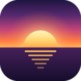
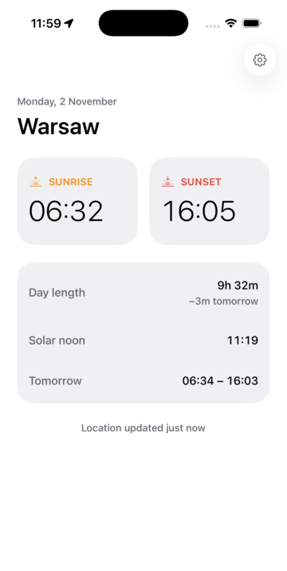

<p align="center">
  
</p>

<h1 align="center">Sunset</h1>

<p align="center">
  Sunrise and sunset times for wherever you are — fully offline, with a home and lock screen widget.
</p>

<p align="center">
  
</p>

## Features

- **Sunrise, sunset & day length** for your current location, plus solar noon, tomorrow's times and how much the day is growing or shrinking.
- **Works offline.** Times are calculated on the device with the [NOAA solar position algorithm](https://gml.noaa.gov/grad/solcalc/calcdetails.html). The last known location is cached, so the app works with no network at all.
- **iOS widget** for the home screen (small, medium) and lock screen (rectangular, inline). It gets a 7-day timeline and switches days on its own, without opening the app.
- **Private by design.** No accounts, no analytics, no ads, no tracking. Your location never leaves your device. See the [privacy policy](PRIVACY.md).
- Handles polar day and polar night, light and dark mode.

## Tech stack

- [Expo](https://expo.dev) SDK 58 · React Native 0.88 · React 19 (React Compiler enabled)
- [Expo Router](https://docs.expo.dev/router/introduction/) for navigation
- [`expo-location`](https://docs.expo.dev/versions/latest/sdk/location/) for the device position and place name
- [`expo-sqlite/kv-store`](https://docs.expo.dev/versions/latest/sdk/sqlite/) to cache the last location
- [`expo-widgets`](https://docs.expo.dev/versions/latest/sdk/widgets/) + [`@expo/ui`](https://docs.expo.dev/versions/latest/sdk/ui/) (SwiftUI) for the widget
- [EAS Build & Submit](https://docs.expo.dev/eas/) for App Store releases

## Getting started

### Requirements

- Node.js 20+
- macOS with Xcode 26+ and an iOS simulator runtime installed (Xcode → Settings → Components)
- CocoaPods 1.15+ (on a recent Ruby, 3.x)

> **Expo Go is not supported.** The widget and native modules need a [development build](https://docs.expo.dev/develop/development-builds/introduction/).

### Run on the iOS simulator

```bash
npm install
npx expo run:ios
```

This generates the native `ios/` project (it is not committed — see [Continuous Native Generation](https://docs.expo.dev/workflow/continuous-native-generation/)), builds the app and starts Metro. After the first build you can just run `npx expo start` and open the installed app.

To try a location in the simulator:

```bash
xcrun simctl location booted set 52.2297,21.0122   # Warsaw
```

To see the widget, go to the home screen, long-press → **Edit** → **Add Widget** → **Sunset**.

### Checks

```bash
npx tsc --noEmit   # typecheck
npx expo lint      # lint
npx expo-doctor    # dependency / config diagnostics
```

## Project structure

```
src/
├── app/                    # Expo Router screens
│   ├── _layout.tsx         # Stack navigator + theming
│   ├── index.tsx           # Home: today's sunrise / sunset
│   └── settings.tsx        # Location & about
├── components/             # UI components
├── constants/theme.ts      # Colors, spacing
├── hooks/
│   └── use-sun-location.ts # Permission, current/cached location, widget refresh
├── lib/
│   ├── sun.ts              # NOAA sunrise/sunset calculation (pure TS, no deps)
│   ├── location-store.ts   # Cached last location (kv-store)
│   └── format.ts           # Time / duration formatting
└── widgets/
    ├── SunWidget.tsx               # Widget layout (SwiftUI via @expo/ui)
    ├── update-sun-widget.ios.ts    # Builds the 7-day widget timeline
    └── update-sun-widget.ts        # No-op on other platforms
```

App configuration (bundle identifiers, widget, permissions, splash, icon) lives in [`app.json`](app.json). Build profiles are in [`eas.json`](eas.json).

## Building & releasing

Builds run in the cloud with [EAS](https://docs.expo.dev/build/introduction/):

```bash
# development build for the simulator
npx eas-cli@latest build -p ios --profile development-simulator

# App Store build + upload to App Store Connect / TestFlight
npx eas-cli@latest build -p ios --profile production
npx eas-cli@latest submit -p ios --latest
```

The first production build asks you to sign in with your Apple Developer account so EAS can create the certificates and provisioning profiles for the app (`com.tobob.sunset`), the widget extension (`com.tobob.sunset.widget`) and the app group (`group.com.tobob.sunset`).

> Forking? Change `ios.bundleIdentifier`, the widget identifiers, `owner` and `extra.eas.projectId` in `app.json` to your own (or remove the last two and run `npx eas-cli@latest init`).

## Privacy

Sunset does not collect any data. See [PRIVACY.md](PRIVACY.md).

## License

[MIT](LICENSE)
